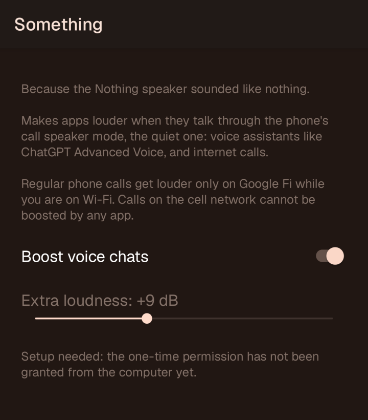
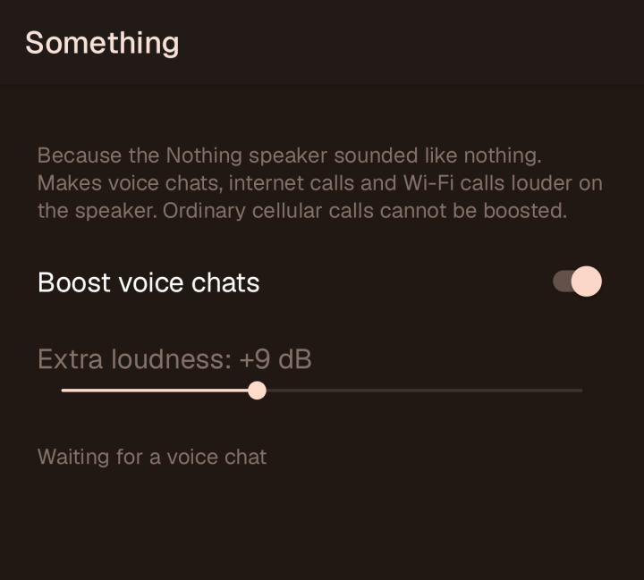
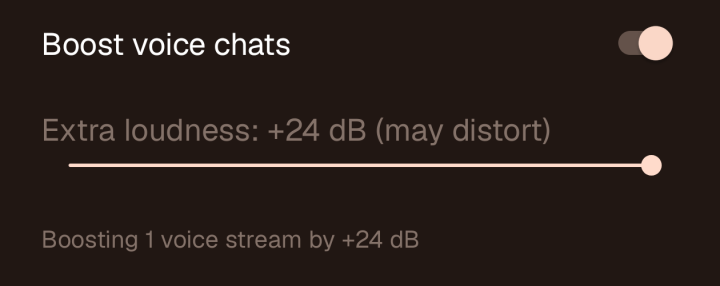

# Something

Because the Nothing speaker sounded like nothing.

Some apps talk through the phone's **call speaker mode**, the same one a phone call uses, and on this phone that
mode is the quiet one. Something is a small Android app that makes those apps louder: voice assistants such as
ChatGPT Advanced Voice and Dots, internet calls, and regular phone calls on Google Fi while you are on Wi-Fi. Regular calls
on the cell network cannot be boosted. No root, no bootloader unlock, no wipe.

It was written for the Nothing Phone (3), where speakerphone voice audio is very quiet even at full volume
([thread 1](https://nothing.community/d/38006-nothing-phone-3-in-call-speaker-volume-too-low),
[thread 2](https://nothing.community/d/52492-low-call-volume-weak-audio-on-nothing-phone-3-help)).
It is not made by, or affiliated with, Nothing.

**[Download the APK](../../releases/latest)** · [Install guide](#install-step-by-step) · [Troubleshooting](#troubleshooting)

## What it does and does not do

| What you are doing | Louder? |
| --- | --- |
| Talking out loud with a voice assistant that uses the call speaker mode, such as **ChatGPT Advanced Voice** or **Dots** | **Yes** |
| Calls made inside an app over the internet | **Yes**, for apps that use the call speaker mode |
| Regular phone calls on **Google Fi while connected to Wi-Fi** | **Yes** |
| Regular phone calls on the **cell network** (no Wi-Fi) | **No** |
| Wi-Fi calling on **other carriers** | **Probably not.** Untested, but most carriers handle it like a cell call. |
| Music and video | No, on purpose. They are already loud. |

**Why regular calls mostly can't be boosted:** on a normal call the sound goes from the phone's radio chip straight
to the speaker. It never passes through the part of Android that apps can touch, so no app can make it louder.
Google Fi on Wi-Fi is the exception, because the Fi app itself carries the call.

**How to tell if an app uses the call speaker mode:** it sounds quiet on speaker while music on the same phone is
loud, and the volume buttons show a call volume slider while it talks.

**Not sure about an app or your calls? Test it in ten seconds:** start the voice chat or call on speaker and open
Something during it. If it says **Boosting**, it gets louder. If it still says **Waiting for a voice chat**, it
can't be boosted.

Tested on one Nothing Phone (3), Nothing OS 5.0 (Android 17). It needs Android 12 or newer. It uses standard
Android APIs, so it may work on other phones, but that is untested.

## What you need

- The phone.
- A computer (Windows, Mac or Linux) and a USB cable, **one time only**, for about five minutes. After setup you
  never need the computer again.

Why a computer: the app needs one permission that Android only allows to be granted from a computer. There is no
button on the phone for it.

## Install, step by step

### Part 1: Install the app on the phone

1. On the phone, open the [latest release](../../releases/latest) and tap the file ending in `.apk` to download it.
2. Open the downloaded file. Android will say your browser is not allowed to install apps: tap **Settings**, turn on
   **Allow from this source**, go back, and tap **Install**.
3. If Google Play Protect asks about an unknown app, choose **Install anyway**. This is normal for any app that is
   not from the Play Store.
4. Open **Something** once. It will say **Setup needed**. That is expected until Part 3 is done.

   

### Part 2: Get the phone and computer talking

1. **Turn on Developer options.** On the phone open **Settings > About phone**, find **Build number** (on Nothing OS
   it may be under **Software info**), and tap it 7 times until it says you are a developer.
2. **Turn on USB debugging.** Open **Settings > System > Developer options** and turn on **USB debugging**.
3. **Get adb on the computer.** Download Google's
   [SDK Platform-Tools](https://developer.android.com/tools/releases/platform-tools) for your system and unzip it.
   You get a folder named `platform-tools`.
4. **Plug the phone into the computer** with the USB cable. The phone asks **Allow USB debugging?** Tap **Allow**.
5. **Open a terminal in the `platform-tools` folder.**
   - Windows: open the folder, click the address bar, type `cmd`, press Enter.
   - Mac or Linux: open Terminal and `cd` into the folder.
6. **Check the connection.** Type this and press Enter:

   ```
   adb devices
   ```

   On Mac or Linux, or in Windows PowerShell, type `./adb devices` instead (and put `./` in front of the command
   in Part 3 too). You should see a line ending in `device`. If it says `unauthorized`, look at the phone and tap
   **Allow**.

### Part 3: Grant the permission

Type this and press Enter:

```
adb shell pm grant app.something.voiceboost android.permission.DUMP
```

No message means it worked. You can unplug the phone now.

### Part 4: Turn it on and keep it on

1. Open **Something**. The **Setup needed** message should be gone, and it should say **Waiting for a voice chat**.

   

2. Leave **Boost voice chats** switched on.
3. Open **Settings > Apps > Something > App battery usage** (or **Battery**), allow background usage, and choose
   **Unrestricted**. This stops the system from shutting the booster down.
4. Optional: turn **USB debugging** back off in Developer options. The app keeps working.

## Using it

- Start a voice chat or a call on the speaker. Within a second or two it gets louder. The app's screen shows
  **Boosting 1 voice stream** and the amount while it works.

  

  (This picture shows the slider at its maximum, +24 dB. It starts at +9.)
- **Extra loudness** sets how much. It starts at +9 dB and goes to +24 dB. Above +15 dB the sound may distort.
  You can move it during a call and hear the change right away.
- The **Something is on** notification means the booster is running. If it is ever missing, open the app once.
- It starts by itself after the phone restarts.

## Troubleshooting

| What you see | What to do |
| --- | --- |
| The app says **Setup needed** | The permission in Part 3 was not granted. Run the command again and check for typos. |
| `adb` is "not recognized" or "not found" | The terminal is not in the `platform-tools` folder. Redo Part 2, step 5. On Mac, Linux or PowerShell use `./adb`. |
| `adb devices` shows nothing | Try another USB cable or port (some cables only charge), and check USB debugging is on. |
| `adb devices` says `unauthorized` | Unlock the phone and tap **Allow** on the USB debugging prompt. |
| The command prints an error about an unknown package | The app is not installed yet. Do Part 1 first. |
| It worked, then stopped after a while | Set battery usage to **Unrestricted** (Part 4, step 3), then open the app once. |
| A voice chat is not louder | Open Something during the chat. If it still says **Waiting for a voice chat**, that app does not play in voice mode, so there is nothing for the booster to attach to. |
| Regular phone calls are not louder | Expected on the cell network and on most carriers; see the table at the top. |
| It sounds harsh or crackly | Lower **Extra loudness**. |
| You reinstalled the app and it says **Setup needed** again | Uninstalling removes the permission. Run the Part 3 command again. Updating over the top keeps it. |

## Uninstall

Remove it like any app: **Settings > Apps > Something > Uninstall**. Nothing else on the phone was changed.

## Is this safe?

**Malware scan of the 1.2 APK:** [VirusTotal: 0 of 65 scanners flagged it](https://www.virustotal.com/gui/file/a0de181f55322ba5297cc3182563e1bae40cb9b4ce320384eeb3080ddb0bcc32).
You can check that your download is the same file: its SHA-256 is
`a0de181f55322ba5297cc3182563e1bae40cb9b4ce320384eeb3080ddb0bcc32`.

- The app has **no internet permission**. It cannot send anything anywhere.
- The `DUMP` permission lets it read the phone's audio status report, which is the only way a normal app can learn
  which audio streams are playing. It reads only that report and uses only the stream ids in it.
- The source is in this repository, and it is short. The APK in Releases is built from it.
- Extra gain can distort, and very loud playback for long periods is hard on a small speaker. Start low. Use at
  your own risk.

## How it works

Android lets an app attach an audio effect to another app's audio session if it knows the session id. Something
reads the list of active players from `dumpsys audio`, picks the ones playing with `USAGE_VOICE_COMMUNICATION`, and
attaches a `LoudnessEnhancer` to each with the gain you chose. It removes the effect when the stream ends.

When an ordinary cellular call starts, it also sends the Qualcomm audio parameter `volume_boost=on`. Whether that
does anything depends on the phone maker's tuning, and it is unverified.

## Build it yourself

```
./gradlew assembleDebug
```

Needs the Android SDK (compile SDK 37) and JDK 17 or newer.

## License

MIT
